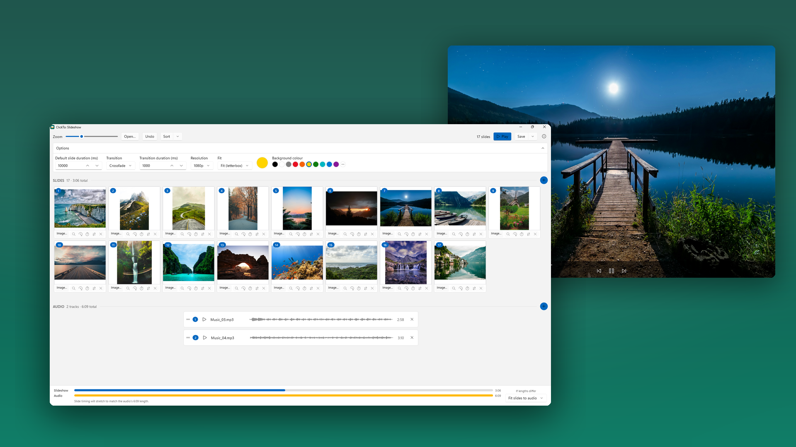
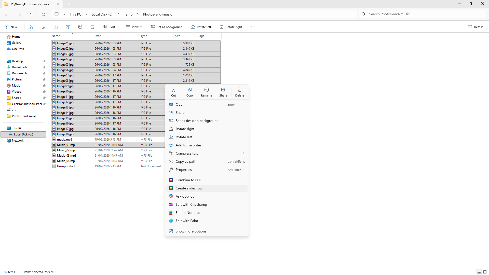
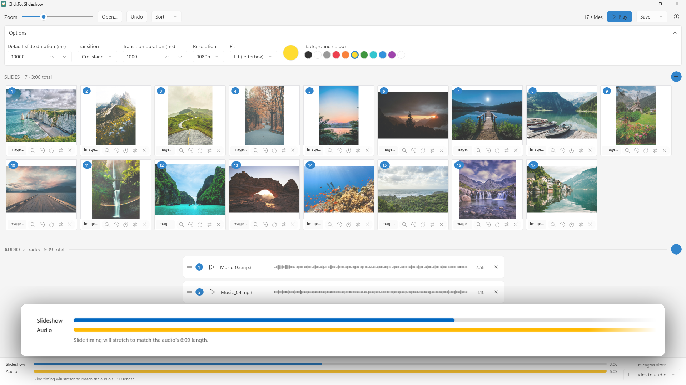
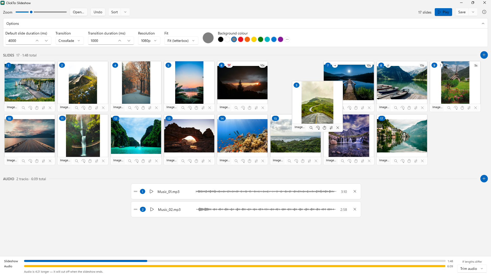
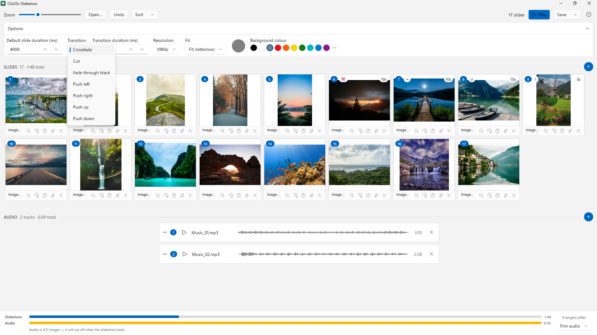
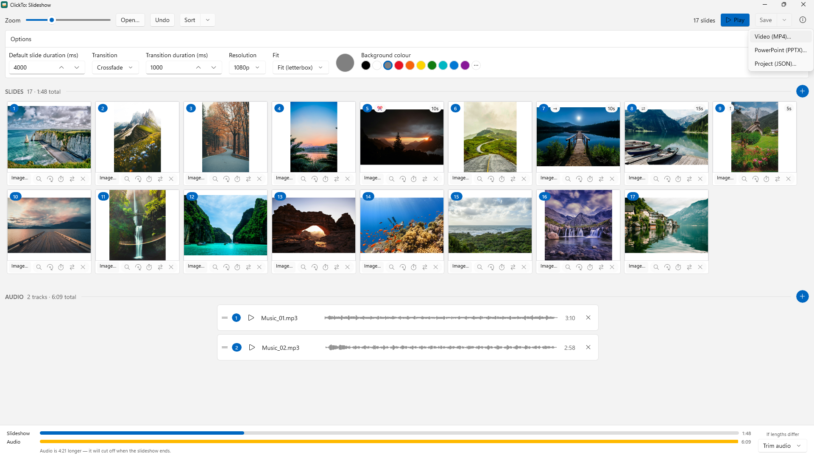

# ClickTo: Slideshow

A Windows app that turns photos and music into a slideshow, straight from File Explorer.
Select your photos (and a song, if you want one), right-click, choose **Create slideshow**,
then arrange the slides, set the timing and transitions, and play it full screen or save it as
an MP4 video or an editable PowerPoint.

> Portfolio snapshot of a shipped project — see [License](#license). The maintained source is
> private; this copy is a point-in-time mirror and won't track every future change.

**Published on the Microsoft Store**, v1.0.2.

## Screenshots


*Arrange photos and music in one window, then play the slideshow full screen.*


*Select photos and music in File Explorer, right-click, and choose "Create slideshow". No need to open the app first.*


*The runtime bar compares the slideshow's length with the music's and lets you choose what happens when they differ.*


*Drag slides into order. Badges mark the slides whose duration or transition differs from the rest.*


*Cut, crossfade, fade through black, or push in any of four directions.*


*Save as an MP4 video, an editable PowerPoint, or a project to come back to later.*

## Why

Making a slideshow from a weekend's photos and one song means either learning a timeline video
editor, building an album before anything will play, or uploading family photos to a website
that watermarks the result. Windows has all the pieces already: image decoding, H.264 encoding
and audio transcoding. It has never joined them up.

## Features

- Right-click photos, a folder or music in File Explorer and choose **Create slideshow**, or drag them onto the window
- Large thumbnails in a reorderable grid; set a duration and transition for every slide or for each one
- Seven transitions: cut, crossfade, fade through black, and push in four directions
- A runtime bar comparing the slideshow's length with the music's, with options to loop the music, trim it or stretch the slides to fit
- Full-screen playback, on a second monitor if there is one
- Save as **MP4** (H.264/AAC), as an editable **PowerPoint** with the transitions, timings and music embedded, or as a project file
- Photos: JPEG, PNG, HEIC/HEIF, WebP, AVIF, TIFF, BMP and camera RAW. Music: MP3, WAV, FLAC, M4A, AAC, WMA, OGG and Opus (OGG/Opus are decoded in-process)
- Sort by name, date taken or date modified; rotate; remove; undo at least 20 steps deep
- Built-in offline Help (F1), with a "Report a problem" flow that sends nothing on its own
- No account, no telemetry, no network calls. Source files are opened read-only

## Tech stack

| Component | Stack |
|---|---|
| Shell extension | Native C++ (WRL), `IExplorerCommand`, which adds the Explorer context-menu entry |
| App UI | C# / .NET 8, WinUI 3 (Windows App SDK), MVVM via CommunityToolkit.Mvvm |
| Frame rendering | [Win2D](https://github.com/microsoft/Win2D): one pure per-frame compose function shared by video export and the full-screen player |
| Video encoding | `MediaStreamSource` → `MediaTranscoder` (WinRT), with frames fed in rather than read from a timeline |
| PowerPoint export | [Open XML SDK](https://github.com/dotnet/Open-XML-SDK), with native PowerPoint transitions and embedded audio |
| OGG / Opus | NVorbis and Concentus |
| Shared UI | [Bureau.Common](https://github.com/gavinjc/Bureau.Common) (git submodule) |
| Packaging | Windows Application Packaging Project → MSIX |
| Tests | xUnit, including pixel-level checks of every transition against synthetic images |

An early design question was whether Windows' `MediaComposition` could do the rendering. It
can't do transitions, so it is used only as a muxer, and every frame is drawn by the app's own
compositor. The reasoning is in
[`docs/clickto-slideshow-decisions.md`](docs/clickto-slideshow-decisions.md) and the write-up
draft [`docs/mediacomposition-writeup-draft.md`](docs/mediacomposition-writeup-draft.md). The
full spec is [`docs/clickto-slideshow-spec.md`](docs/clickto-slideshow-spec.md), and
[`docs/CURRENT_APPLICATION.md`](docs/CURRENT_APPLICATION.md) describes what was actually built.

## Project layout

```
src/
  ClickToSlideshow.Core/            Timeline model, frame composer, transitions, MP4 render, audio, PPTX read/write
  ClickToSlideshow.App/             WinUI 3 editor and full-screen player
  ClickToSlideshow.Cli/             Headless renderer used to validate the engine
  ClickToSlideshow.ShellExtension/  Native C++ IExplorerCommand implementation
  ClickToSlideshow.Package/         MSIX packaging project
tests/
  ClickToSlideshow.Core.Tests/
  ClickToSlideshow.App.Tests/
external/
  Bureau.Common/                    Shared About/Help/message-bar chrome (submodule)
```

## Download

**ClickTo: Slideshow** is free on the Microsoft Store:

**[Get it from the Microsoft Store](https://apps.microsoft.com/detail/9PLKC14MGC3N)**

## Building from source

Clone with submodules: `git clone --recursive https://github.com/gavinjc/ClickToSlideshow`.
GitHub's "Download ZIP" leaves the submodule out, so the solution won't build from a ZIP.

Requires Visual Studio 2022 with the ".NET desktop development", "Desktop development with C++"
and "Windows application development" workloads. Open `ClickToSlideshow.sln` and run the
`ClickToSlideshow.App` project directly, or build `ClickToSlideshow.Package` to produce an
MSIX package.

## License

All rights reserved — see [LICENSE](LICENSE). The source is shared here for portfolio purposes;
no rights to reuse, modify or redistribute it are granted.
